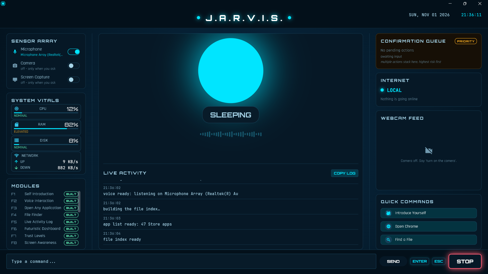

# JARVIS

A local-first voice assistant that explains every decision it makes, asks before anything risky, and shows you exactly what would go online before it does.

**Runs on Windows 10/11 (full features) and macOS (most features).**



## What it does

Say "Hey Jarvis" and talk to her. JARVIS can:

- **Open apps and websites** installed on your laptop ("open notepad", "open YouTube").
- **Find files** by name and open the one you pick from a numbered list.
- **Answer questions**: the time and date offline, general and live questions online (Groq), and the **weather** (Open-Meteo).
- **Remember things** you ask her to, and forget them when you ask (passwords, PINs and card numbers are never stored).
- **Look at your screen** (Windows OCR) and **through the webcam** (local object detection, with rough price ranges).
- **Read and summarise documents** (PDF, Word, text, CSV) and **YouTube videos**.
- **Track news topics** and give you a **morning briefing** (weather plus headlines).
- **Change system settings**: volume, brightness, Wi-Fi, lock, restart and shut down (locking, Wi-Fi, restart and shut down ask for confirmation).
- **Search Google** in your own Chrome.

## What makes JARVIS different

- **Explainable "why did you do that?"**: she answers from her own decision record (what she heard, how she understood it, which rule applied), never from a model's guess.
- **Trust levels L0 to L4 with confirmations**: every action has a fixed trust level. Answers and safe actions run at once; risky ones wait for "confirm" (L2/L3); the most serious, such as shutting down or forgetting everything, need two confirms (L4).
- **Privacy previews before anything goes online**: before your screen or a file's text is sent anywhere, the dashboard shows exactly what will be sent and waits for "confirm". Private windows are blacked out.
- **Live Activity dashboard**: every step appears as it happens: what she heard, how she understood it, what she did, whether it was verified, and whether anything went online.
- **Conversation and sleep mode**: say "Hey Jarvis" once and keep talking; say "go to sleep" and she listens only for her name again.
- **Local-first, works offline**: the wake word, speech-to-text, her voice, file search, memory, the camera and screen reading all run on your laptop. Only questions that need the web go online, and when the internet is down she says so plainly.
- **Personality**: greetings that vary by time of day, a gentle check-in when you sound frustrated, a calm reply to rudeness (she still does what you asked), and her own neural voice (Kokoro).

## Requirements

- Windows 10 or 11 (64-bit), or macOS
- [Python 3.11](https://www.python.org/downloads/release/python-3117/) (Windows: 64-bit, tick "Add python.exe to PATH" when installing; macOS: the universal2 installer)
- A microphone (a webcam is optional, for the camera features)
- Internet for the one-time setup and for online features (questions, weather, news, YouTube)
- About 1.5 GB of free disk space (the installed packages take about 730 MB and the models about 520 MB)

## Download and run

### Windows

1. On GitHub, click **Code → Download ZIP** (or `git clone` the repository).
2. Unzip it anywhere.
3. Double-click **`setup.bat`**. The first run can take up to about 20 minutes: it creates a virtual environment, installs the packages (about 730 MB) and downloads the models (about 520 MB).
4. Optional: get a free Groq API key at [console.groq.com](https://console.groq.com/keys) and paste it after `GROQ_API_KEY=` in the `.env` file that setup created. JARVIS works without it; online questions then tell you how to set it up.
5. Double-click **`run.bat`**.
6. Say **"Hey Jarvis"**.

### macOS

1. On GitHub, click **Code → Download ZIP** (or `git clone` the repository) and unzip it.
2. Open Terminal in the JARVIS folder and run **`bash setup.sh`** (same steps as `setup.bat`: Python 3.11 check, virtual environment, packages, models, `.env`). If a pinned package has no macOS build, it retries with `requirements-mac.txt`, where five packages are unpinned, and says which.
3. Optional: add your free Groq key to `.env`, as on Windows.
4. Run **`bash run.sh`**.
5. When macOS asks, allow **Microphone**, **Camera** and **Screen Recording** for Terminal (System Settings → Privacy & Security). Then say **"Hey Jarvis"**.

On both systems you can also start it with `python main.py` from the activated virtual environment, or type commands into the box at the bottom of the dashboard.

### What is different on macOS

| Feature | Windows | macOS |
|---|---|---|
| Global hotkeys (`Ctrl+Shift+X` stop, `Ctrl+Shift+Space` push-to-talk) | Yes | No (they would need extra permissions). Stop with the STOP button, `Esc` in the window or by saying "stop"; type a command instead of push-to-talk. |
| Brightness | Yes | No: she says "Changing brightness isn't supported on macOS." |
| Reading text on the screen ("what's on my screen", "find X on my screen") | Yes (Windows OCR) | No: she suggests "explain my screen", which works (the picture is sent only after the preview and "confirm"). |
| Private windows blacked out in screen previews | Yes | No window list on macOS: check the preview before you confirm. |
| Opening apps, files and websites | Start Menu, Store apps, Chrome | `.app` bundles in /Applications, /System/Applications and ~/Applications; `open`; Chrome or the default browser. Scripts are shown in Finder, never run. |
| Volume, mute, Wi-Fi, lock, restart, shut down | Windows APIs | `osascript`, `networksetup`, `pmset displaysleepnow` (lock = display sleep). Same confirmations. |
| Time in another city | Yes | No (the time-zone data JARVIS uses is Windows-only); local time and date work. |
| Fallback voice (if the Kokoro model is missing) | Windows SAPI | macOS's own voice through pyttsx3 |

macOS support was tested by simulating macOS on Windows (see [Testing](#testing)); it has not yet been run on a real Mac.

## Things to say

| Feature | Try saying |
|---|---|
| Introduction | "Introduce yourself" |
| Apps and websites | "Open notepad", "Open YouTube" |
| Files | "Find my report", then "open number one" |
| Why | "Why did you do that?" |
| Time and date | "What time is it?", "What's the date?" |
| Questions | "What is photosynthesis?" |
| Weather | "What's the weather in Sydney?" |
| Memory | "Remember my exam is on Friday", "What do you remember?", "Forget everything" |
| Screen | "What's on my screen?", "Explain my screen" |
| Camera | "What can you see?", "How much is this?", "Turn on the camera" |
| Documents | "Summarize my report" |
| YouTube | "Play lofi beats on YouTube", "Summarize this video" |
| Web search | "Search best pizza in Sydney" |
| News topics | "Track solar power", "What am I tracking?" |
| Morning briefing | "Brief me" |
| System settings | "Volume up", "Set the brightness to 70", "Turn Wi-Fi off", "Lock the laptop" |
| Sleep | "Go to sleep" (wake her with "Hey Jarvis") |
| Confirmations | "Confirm" or "Cancel" |

## Stop and push-to-talk

| Key | What it does |
|---|---|
| `Ctrl+Shift+X` | Stop: cancels whatever she is doing, from any state |
| `Esc` (in the window) | Stop |
| `Ctrl+Shift+Space` | Push-to-talk: one command without saying the wake word |

Saying "stop" works too. The keyboard shortcuts are Windows-only; on macOS use the STOP button, `Esc` or the spoken "stop".

## Privacy and safety

- Your data stays in the `jarvis_data/` folder on your laptop. It is never uploaded, and it is excluded from the repository.
- Nothing from your laptop (screen, file text) goes online without a preview and your "confirm".
- Passwords, PINs, card and account numbers are refused by memory and redacted from every log.
- Locking, Wi-Fi changes and anything hard to undo need a spoken confirmation (two for restart, shut down and forgetting everything).
- Your Groq key lives only in `.env`, which is git-ignored.
- The camera and screen are used only when you ask, and the dashboard shows when each one is on.

## COMP9001 advanced concepts

The first location in each row has a comment directly above it naming the concept.

| Topic | Where | Why it matters |
|---|---|---|
| **Classes & Objects** (abstract class, inheritance, frozen dataclass) | `jarvis/speech/output.py:16` (`SpeechOutput`, abstract), `jarvis/speech/neural_tts.py:274` (`NeuralSpeechOutput` subclass), `jarvis/controller/permits.py:29` (frozen `Permit`), `jarvis/controller/controller.py:49` (`Controller`) | The orchestrator calls `speak()` without knowing whether the voice is Kokoro, Windows' Zira or a silent test fake, so a missing voice model degrades instead of crashing. A frozen `Permit` can't be changed after it is issued, so an action runs exactly as approved. One `Controller` object owns all state, which makes the trust levels enforceable. |
| **Collections** (deque, dict, Counter) | `jarvis/logbook/logbook.py:41` (`deque(maxlen=...)`), `jarvis/voice/listener.py:206` (audio pre-roll deque), `jarvis/controller/trust.py:102` (`TRUST_TABLE` dict), `jarvis/vision/commands.py:192` (`Counter`) | A bounded deque keeps the newest decision records, and the last audio frames before speech, at a fixed memory cost. The trust table is a dict lookup, so a trust level is fixed data, never a guess. `Counter` turns detections into "two cups and a bottle". |
| **File I/O** (JSON with atomic writes, CSV, TOML) | `jarvis/memory/store.py:206` (`_write_file`), `jarvis/vision/prices.py:54` (CSV), `jarvis/settings/__init__.py:27` (TOML) | Memories are written to a `.tmp` file and swapped in with `os.replace()`, so a crash never leaves a half-written file. Prices come from a CSV table, and every tunable number is read from `settings.toml`. |
| **Flow control & error handling** (loops, try/except, custom exceptions) | `jarvis/online/service.py:106` (bounded retry loop), `jarvis/dashboard/app.py:2035` (shutdown steps), `jarvis/memory/store.py:79` (`MemoryFull`) | Every online call has a timeout, one retry and a cooldown, and each failure becomes a classified error with a plain spoken message, so no traceback reaches you. At shutdown each step is wrapped separately, so one failure never stops the rest. |
| **Testing** (pytest, fixtures, mocking) | `tests/conftest.py:64` (autouse safety fixture), `tests/` (2,060 tests) | The autouse fixture replaces every real app/URL opener and system setter with a stub that fails the test, so the suite can never open an app or change a setting. External services are faked, so the suite runs offline. |
| **Iterators & generators** | `jarvis/actions/file_index.py:150` (`walk_root`), `jarvis/sensors.py:35` (`@contextmanager`) | `walk_root` yields one file at a time while walking the disk, so no big intermediate list is built. The generator-based context manager turns the sensor indicator off in `finally`, even when a capture fails. |
| **Recursion** | `jarvis/logbook/records.py:121` (`redact_value`), `jarvis/system/commands.py:88` (`to_number`) | Action parameters can nest dicts inside lists to any depth; `redact_value` recurses through them so no secret is written to a log. `to_number` reads "two hundred and five" by calling itself on "two" and on "five". |

## Project structure

```
main.py             entry point (run this)
setup.bat run.bat   Windows: one-time setup, start
setup.sh run.sh     macOS: one-time setup, start
jarvis/             the application, one package per feature area
  platform/         Windows and macOS implementations of what differs
  controller/       state machine, trust levels, permits
  voice/ speech/    wake word, speech-to-text, her voice, online answers
  actions/          local commands (apps, files, weather, clock, ...)
  dashboard/        the Flet window
  settings/         settings.toml, intents.toml, intro text, price table
scripts/            model download (run by setup.bat), detector evaluation
tests/              pytest suite (offline, everything external mocked)
```

See [ARCHITECTURE.md](ARCHITECTURE.md) for how a command travels through the system, and [USER_MANUAL.md](USER_MANUAL.md) for a full guide.

## Testing

From the project folder, after `setup.bat`:

```
venv\Scripts\python.exe -m pytest tests -q
```

2,060 tests pass on Windows. They run offline and never open apps, change settings or touch your data. 48 of them (`tests/test_platform_mac.py`) simulate macOS by setting `sys.platform` to "darwin" and recording every macOS command instead of running it, including a check that importing JARVIS on macOS loads no Windows-only module. A further 265 end-to-end tests drive the real models and voice pipeline (several minutes, a few real online calls); they are skipped by default and run with `python -m pytest tests -m e2e`.

## Credits

All JARVIS code was written for this project. The name is a tribute to JARVIS from Iron Man. These libraries, models and services are used under their own licences:

| Used for | Library / model / service | Licence |
|---|---|---|
| Speech-to-text | faster-whisper (Systran), Whisper base.en model (OpenAI) | MIT |
| Her voice | Kokoro-82M model, kokoro-onnx | Apache-2.0, MIT (eSpeak NG via espeakng-loader: GPL-3.0; phonemizer: GPL-3.0) |
| Fallback voice | pyttsx3 (Windows SAPI) | MPL-2.0 |
| Wake word | openWakeWord, "hey jarvis" model | Apache-2.0 (code), CC BY-NC-SA 4.0 (pre-trained models) |
| Object detection | YOLOX-S (Megvii), onnxruntime | Apache-2.0, MIT |
| Speech models runtime | CTranslate2, numpy, scipy | MIT, BSD-3-Clause, BSD-3-Clause |
| Online answers | Groq API (groq SDK) | service terms; SDK Apache-2.0 |
| Weather | Open-Meteo API | CC BY 4.0 data, free non-commercial use |
| News headlines | RSS feeds, parsed with defusedxml | each feed's terms; PSF |
| YouTube transcripts | youtube-transcript-api | MIT |
| Dashboard | Flet | Apache-2.0 |
| Gauges | psutil | BSD-3-Clause |
| Microphone | sounddevice (PortAudio) | MIT |
| Screen and camera | Pillow, Windows OCR via pywinrt, opencv-python-headless | MIT-CMU, MIT, Apache-2.0 |
| Documents | pypdf, python-docx, lxml | BSD-3-Clause, MIT, BSD-3-Clause |
| System settings | pycaw, screen-brightness-control, WMI, pywin32 | MIT, MIT, MIT, PSF-2.0 |
| Secrets, HTTP | python-dotenv, httpx, huggingface_hub (model downloads) | BSD-3-Clause, BSD-3-Clause, Apache-2.0 |
| Fonts | Orbitron, Rajdhani, JetBrains Mono | SIL OFL 1.1 |
| Tests | pytest; YOLOX sample photo (`tests/fixtures/yolox_dog.jpg`) | MIT; Apache-2.0 |

## License

MIT. See [LICENSE](LICENSE).
